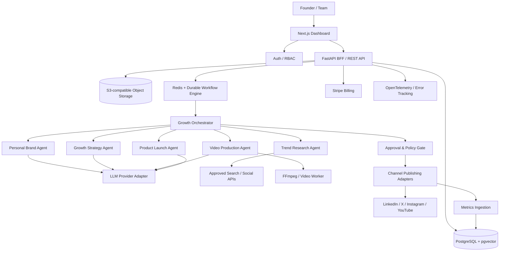

# FounderOS — Technical Architecture

**Version:** 1.0 | **Status:** Implementation blueprint | **Product:** AI founder growth and personal branding SaaS

## 1. Product scope
FounderOS combines five cooperating agents: (1) Founder Growth, (2) Video Creator, (3) Personal Brand, (4) Viral Content Research, and (5) Product Launch. A founder supplies a website, brand assets, target audience, preferred channels, and goals. The platform produces research-backed strategies, authentic drafts, video assets, and launch plans; publishing and external outreach require explicit authorization.

### Non-goals for MVP
- Guaranteed viral growth, fake engagement, mass unsolicited DMs, automated impersonation, or account scraping.
- Unsupervised publishing or spending money on ads.
- Arbitrary browser automation to bypass platform API restrictions.
- Real-time trend predictions without source timestamps and evidence.

## 2. Architecture diagram

## 3. Recommended technology stack
| Layer | Choice | Why |
|---|---|---|
| Frontend | Next.js + TypeScript + Tailwind + shadcn/ui | Responsive dashboard and fast iteration |
| API | Python 3.12 + FastAPI + Pydantic | Typed contracts, straightforward AI integrations |
| Authentication | Managed OIDC (Clerk/Auth0/Supabase Auth) | OAuth, sessions, MFA, team invites |
| Authorization | Workspace-scoped RBAC in API | Tenant isolation and approvals |
| Database | PostgreSQL + pgvector | Relational data, semantic retrieval for brand memory |
| Cache / throttling | Redis | Rate limits, idempotency, caching |
| Durable orchestration | Temporal (or equivalent) | Retries, timers, resumable human approval steps |
| AI model | Provider-neutral LLM gateway | Structured output, fallback, cost accounting |
| Video | FFmpeg workers + optional licensed TTS/STT APIs | Captions, templates, rendered MP4 |
| Storage | S3-compatible object store | Uploads, render artifacts, signed URLs |
| Analytics | Postgres events + channel insights APIs | Attribution and reporting |
| Payments | Stripe | Subscriptions, usage metering |
| Infrastructure | Docker + managed Postgres/Redis + container hosting | Start simple; separate video workers |
| Observability | OpenTelemetry, Sentry, structured logs | Traces, alerts, failure debugging |

## 4. Service boundaries
- **Web app:** onboarding, brand profile, research feed, calendar, editor, video studio, launch workspace, approvals, analytics, billing.
- **Core API:** validates auth and workspace scope; exposes CRUD, triggers jobs, returns job status.
- **Orchestrator:** composes workflows with typed inputs/outputs; handles budgets, retries, dependencies, and approvals. Agents do not call one another directly.
- **Agent workers:** isolated research, writing, planning, and video generation tasks. All return structured artifacts with evidence and provenance.
- **Publisher:** separate privileged service; uses official APIs and only approved, version-pinned assets.
- **Analytics:** ingest platform data subject to provider permissions; calculate reach, engagement, profile visits, site visits, signups, and attributed conversions when instrumentation is available.

## 5. Agent contracts
All agents accept `workspace_id`, `campaign_id`, `goal`, `brand_context_version`, `constraints`, `budget`, and `trace_id`. All emit `artifact_id`, `artifact_type`, `content`, `citations`, `confidence`, `estimated_cost`, `warnings`, and `status`.

### A. Personal Brand Agent
**Inputs:** founder interview, website, biography, approved writing samples, values, audience, tone, forbidden claims. **Outputs:** versioned `BrandVoiceProfile`, audience personas, story bank, messaging pillars, voice examples, claim policy. **Tools:** website fetch with SSRF protections, embeddings, approved document retrieval. **Rules:** no fabricated accomplishments, quotations, testimonials, or personal history; founder approves the initial brand profile.

### B. Viral Content Research Agent
**Inputs:** audience, niche, channels, geography, timeframe. **Outputs:** `TrendOpportunity[]` with URL, publisher, observed timestamp, evidence, relevance score, originality angle, uncertainty, and suggested hook. **Tools:** permitted search, RSS, provider APIs. **Rules:** honor ToS, quotas and robots; distinguish observed engagement from predicted outcomes; never claim guaranteed virality.

### C. Founder Growth Agent
**Inputs:** brand profile, goals, research opportunities, channel analytics, available founder time. **Outputs:** `GrowthPlan`, weekly content calendar, channel experiments, KPI targets, creative briefs. **Tools:** analytics query, planning LLM, scheduler. **Rules:** propose measurable hypotheses; prioritize business outcomes; do not automatically modify campaign budgets.

### D. Video Creator Agent
**Inputs:** approved script/brief, media library, visual style, consented voice/avatar settings, target aspect ratio. **Outputs:** script, storyboard, subtitles, thumbnail, rendered MP4, platform captions. **Pipeline:** script -> review -> scene plan -> select licensed media -> optional TTS -> FFmpeg render -> QA -> final approval. **Rules:** consent for likeness/voice, licensed assets, disclosure where applicable, no unauthorized impersonation.

### E. Product Launch Agent
**Inputs:** product URL, launch date, positioning, proof points, target channels, offer, goals. **Outputs:** `LaunchPlan`, pre-launch checklist, landing copy, teaser assets, email drafts, day-of schedule, post-launch review. **Rules:** external posts and emails must pass review; account for platform-specific constraints and launch timing.

## 6. Primary workflows
### Founder onboarding
1. Create workspace and verify account.
2. Import product URL with safe fetcher; extract positioning and product claims.
3. Conduct a short founder interview; upload logo, examples, optional headshot/voice with consent.
4. Brand Agent generates a profile; founder edits and approves it.
5. Set channels, posting cadence, goals, and consent preferences.

### Weekly growth cycle
1. Trend Agent gathers source-backed opportunities.
2. Growth Agent produces channel strategy and calendar.
3. Brand Agent checks voice and claim fidelity.
4. Video Agent renders selected short-form assets.
5. Drafts enter review queue with exact revision hashes.
6. Founder approves each post/channel/time; publisher schedules through supported APIs.
7. Metrics ingestion and attribution feed next week's experiment selection.

### Product launch
1. Create launch project with target date.
2. Launch Agent builds phased plan: T-14 through T+7 (configurable).
3. Generate assets, landing copy, video briefs, and launch posts.
4. Founder reviews, approves and schedules.
5. Launch dashboard shows execution, engagement, referral traffic, and conversions.

## 7. Data model
Core tables (all tenant-scoped where relevant):
- `users(id, auth_subject, email, created_at)`
- `workspaces(id, name, owner_id, plan, created_at)`
- `memberships(workspace_id, user_id, role)` roles: owner/admin/editor/viewer
- `products(id, workspace_id, url, description, audience, value_prop)`
- `brand_profiles(id, workspace_id, version, voice_json, pillars_json, approved_at)`
- `brand_sources(id, workspace_id, kind, source_url, text_ref, consent_record_id)`
- `social_connections(id, workspace_id, provider, account_ref, encrypted_token_ref, scopes, expires_at)`
- `campaigns(id, workspace_id, kind, goal_json, status, starts_at, ends_at)`
- `trend_sources(id, workspace_id, url, publisher, observed_at, metrics_json)`
- `opportunities(id, campaign_id, source_ids, angle, score, rationale)`
- `content_items(id, workspace_id, campaign_id, channel, kind, state, current_revision_id)`
- `content_revisions(id, content_item_id, revision_hash, text, asset_refs, created_by)`
- `media_assets(id, workspace_id, storage_key, mime, rights_json, consent_record_id)`
- `approvals(id, workspace_id, revision_id, channel, scheduled_at, approver_id, status)`
- `publishing_jobs(id, approval_id, provider, idempotency_key, status, external_post_id)`
- `launch_projects(id, workspace_id, campaign_id, launch_at, checklist_json)`
- `agent_runs(id, workspace_id, agent, input_ref, output_ref, status, cost_usd, trace_id)`
- `analytics_events(id, workspace_id, campaign_id, content_item_id, source, event_type, event_at, metadata_json)`
- `subscriptions(id, workspace_id, stripe_customer_id, status, plan)`
- `usage_ledger(id, workspace_id, kind, quantity, estimated_cost_usd, created_at)`
- `audit_logs(id, workspace_id, actor_id, action, resource_id, metadata_json, created_at)`

Add foreign keys, unique constraints, workspace indexes, row-level security where appropriate, and encrypted credential references. Embeddings are stored separately with workspace scope and retention policy.

## 8. API surface (v1)
| Method | Endpoint | Purpose |
|---|---|---|
| POST | `/v1/workspaces` | Create workspace |
| POST | `/v1/onboarding/import` | Import product website |
| POST | `/v1/brand/interview` | Save founder responses |
| POST | `/v1/brand/generate` | Start brand-profile workflow |
| POST | `/v1/brand/{id}/approve` | Approve brand version |
| POST | `/v1/research/runs` | Start trend discovery |
| GET | `/v1/research/opportunities` | List source-backed ideas |
| POST | `/v1/growth/plans` | Generate weekly plan |
| GET | `/v1/content` | Content calendar and drafts |
| POST | `/v1/content/{id}/revisions` | Save edited revision |
| POST | `/v1/videos/render` | Start video render |
| POST | `/v1/content/{id}/approve` | Approve exact revision/channel/time |
| POST | `/v1/content/{id}/schedule` | Queue approved post |
| POST | `/v1/launches` | Create launch campaign |
| GET | `/v1/analytics/overview` | Metrics and conversions |
| GET | `/v1/jobs/{id}` | Workflow state and errors |
| POST | `/v1/billing/checkout` | Start Stripe checkout |
| POST | `/v1/webhooks/stripe` | Verify and process billing events |

Use bearer auth, workspace ownership checks, request validation, pagination, 429 limits, and idempotency keys for mutations. External OAuth uses state + PKCE where supported, narrow scopes, and encrypted server-side token storage.

## 9. Content lifecycle and safety
`idea -> draft -> needs_review -> approved -> scheduled -> publishing -> published` with `rejected`, `failed`, and `cancelled` branches. Editing an approved revision invalidates approval. Approval binds immutable revision hash, provider, destination account, schedule, and asset references. Workers revalidate approval at send time. No auto-DMs, fake reviews, engagement bots, fabricated quotes, or undisclosed paid endorsements. Human approval is mandatory for external publishing in MVP.

## 10. Security, privacy, reliability
- Strict tenant isolation at query and storage layers; role-based permissions; server-side authorization on every endpoint.
- Encrypt tokens and sensitive media; redact logs; rotate secrets; signed expiring asset URLs.
- Defend against prompt injection from fetched websites and social content; treat retrieved content as untrusted data and restrict agent tools.
- Safe URL fetcher blocks private networks, metadata endpoints, redirects to internal IPs, oversized downloads, and unsupported MIME types.
- Data deletion/export, consent records for biometric/voice material, configurable retention, least-privilege platform scopes.
- Per-workspace LLM/render spend caps, retry budgets, circuit breakers, dead-letter queues, idempotent jobs.
- Separate video rendering workers with CPU/memory/time quotas and sandboxed FFmpeg execution.
- Metrics should disclose data gaps, attribution uncertainty, and API access limitations.

## 11. Deployment topology
`web` and `api` run as stateless containers; `temporal-worker` runs agent workflows; `video-worker` has separate resource limits; managed Postgres, Redis, object storage, and workflow backend support them. CI runs lint/type checks, migrations in staging, integration tests, and canary deploys. Use separate development/staging/production credentials and OAuth apps.

## 12. Success metrics
Activation: founder completes brand profile and approves first content calendar. Product: approved posts per active workspace, weekly active founders, video render success, on-time publication, launch completion. Business: attributed signups, qualified leads, paid conversion, retention, gross margin after LLM/video/API costs. Guardrails: approval bypass incidents (target zero), unauthorized posts (zero), failed publishing rate, API quota errors, factual claim corrections.

## 13. Key design decisions and risks
- Start with LinkedIn and X text content; add Instagram/YouTube video publishing only after app review, eligibility, and API access are confirmed.
- Begin with script + template-based video editing, not expensive avatar generation; add avatar/voice generation only with verified consent.
- Store citations and timestamps for trends; score relevance instead of pretending to forecast virality.
- Prefer a modular monolith plus durable workers initially; split services only after measured scaling bottlenecks.
- Provider API access, platform policies, content rights, rendering costs, and attribution gaps are first-class delivery risks.
