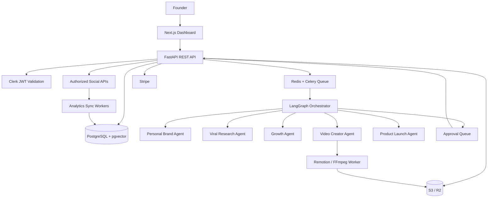

# FounderOS — Implementation Framework

**Version:** 1.0
**Architecture:** Modular monolith with asynchronous AI and media workers
**Product:** AI-powered founder growth, personal branding, video creation, trend research, and product launch management

## 1. Objectives

Build a multi-tenant SaaS platform where founders can create a brand profile, research audience trends, generate content and videos, plan product launches, approve publishing, and measure results. The system coordinates five specialized AI agents while retaining human approval for public posts and outreach.

### Five agents
1. **Founder Growth Agent:** Builds channel strategy, editorial calendars, experiments, and performance reviews.
2. **AI Video Creator Agent:** Produces scripts, storyboards, captions, asset plans, and render jobs.
3. **Personal Brand Agent:** Maintains founder voice, positioning, story, and brand guidelines.
4. **Viral Content Research Agent:** Finds relevant trends, analyzes hooks and topics, and recommends original angles; does not promise virality.
5. **Product Launch Agent:** Plans launch timelines, assets, announcements, and post-launch reporting.

## 2. Technology Decisions

### Frontend
| Layer | Framework | Responsibility |
|---|---|---|
| Application | Next.js App Router + TypeScript | Routes, rendering, server components |
| Styling | Tailwind CSS | Responsive styles |
| UI primitives | shadcn/ui | Accessible, reusable components |
| Remote data | TanStack Query | API caching, loading, retries |
| Client state | Zustand | Local UI and editor state |
| Forms | React Hook Form + Zod | Input handling and validation |
| Charts | Recharts | Growth and campaign dashboards |
| Video preview | Remotion Player | Timeline and video preview |
| Auth UI | Clerk | Sign-in and organization switching |

### Backend
| Layer | Framework | Responsibility |
|---|---|---|
| HTTP API | FastAPI + Python 3.12+ | Typed REST endpoints and webhooks |
| Validation | Pydantic v2 | Request and response schemas |
| Persistence | PostgreSQL + SQLAlchemy 2 | Tenant data and transactions |
| Migrations | Alembic | Schema versioning |
| Semantic retrieval | pgvector | Brand knowledge and retrieval |
| AI orchestration | LangGraph | Stateful agent workflows and checkpoints |
| Model access | OpenAI API behind provider adapter | Text generation and structured outputs |
| Background jobs | Celery + Redis | Research, generation, publishing, analytics |
| Media | Remotion + FFmpeg in separate Node worker | Video composition and encoding |
| Object storage | S3-compatible API (S3 or R2) | Media assets and exports |
| Payments | Stripe | Subscription and metered usage |
| Observability | OpenTelemetry + Sentry | Tracing, errors, diagnostics |

**Key design decision:** FastAPI serves requests; Celery workers execute slow jobs. Remotion rendering is a Node/TypeScript worker, not a Python process. The AI orchestrator delegates work to domain-specific agents but all agents share common tenant-aware services.

## 3. Logical Architecture

### Execution rules
- All reads and writes are scoped to an organization/tenant ID; enforce membership and roles server-side.
- Agents return structured artifacts and proposed actions, not unrestricted tool execution.
- Posting, messaging, and paid actions require explicit authorization and appropriate platform permissions.
- External API calls are idempotent where possible; retry with backoff and record failures.
- Store credentials encrypted in a managed secrets system; do not put platform tokens into prompts.
- Maintain audit logs for approvals, publishes, billing events, and agent actions.

## 4. Frontend Modules and Routes

| Route | Module | Core UI |
|---|---|---|
| `/onboarding` | Founder onboarding | Product URL, audience, goals, founder interview |
| `/dashboard` | Growth Command Center | Goals, tasks, campaign status, metrics |
| `/brand` | Personal Brand Studio | Voice profile, story, approved examples |
| `/research` | Trend Research | Sources, topics, ideas, evidence, saved angles |
| `/content` | Content Workspace | Drafts, edits, variants, approval status |
| `/video` | Video Studio | Scripts, assets, timeline preview, render status |
| `/calendar` | Publishing Calendar | Scheduled content and channel filters |
| `/launches` | Product Launch Manager | Milestones, campaign assets, checklist |
| `/analytics` | Analytics | Reach, clicks, signups, conversions |
| `/integrations` | Connected Accounts | OAuth, permissions, health, disconnect |
| `/settings/billing` | Subscription | Plan, credits, invoices, usage |

Use server components for initial page data and client components for editors, charts, and live job updates. Use polling or server-sent events for long-running jobs; never hold an HTTP request open for an entire render.

## 5. Backend Modules

- `api`: Versioned REST routes and webhooks.
- `auth`: JWT verification, membership checks, role-based permissions.
- `agents`: LangGraph orchestrator, typed agent states, prompts, tool adapters.
- `brand`: Brand voice, positioning, knowledge ingestion.
- `research`: Trend-source connectors, source provenance, deduplication.
- `content`: Drafts, variants, revisions, approval state machine.
- `video`: Script/storyboard generation and render job coordination.
- `launch`: Campaign milestones, dependencies, deliverables.
- `publishing`: OAuth integrations, scheduling, posting, reconciliation.
- `analytics`: Metric ingestion, attribution, experiment reports.
- `billing`: Stripe customer mapping, entitlements, usage accounting.
- `workers`: Queue tasks, retries, job status, dead-letter handling.

## 6. Core Data Model

Use UUID primary keys, timestamps, organization IDs, and appropriate unique constraints.

| Table | Purpose |
|---|---|
| `users`, `organizations`, `memberships` | Identity and tenancy |
| `founder_profiles`, `brand_guidelines` | Personal story, voice, positioning |
| `knowledge_documents`, `knowledge_embeddings` | Brand reference material |
| `connected_accounts` | OAuth metadata and encrypted token references |
| `agent_runs`, `agent_steps` | Orchestration state, cost, status, trace IDs |
| `research_sources`, `trend_insights` | Research evidence and generated opportunities |
| `content_items`, `content_versions` | Drafts and revision history |
| `video_projects`, `render_jobs`, `media_assets` | Video production lifecycle |
| `campaigns`, `launch_tasks` | Product launch planning |
| `approvals`, `publish_jobs`, `published_posts` | Approval and publication tracking |
| `metric_snapshots`, `experiments` | Performance measurements |
| `subscriptions`, `usage_events` | Billing and quota enforcement |
| `audit_events` | Security-sensitive action history |

Recommended indexes: `(organization_id, created_at)` on high-volume tables, unique `(platform, external_post_id)` where applicable, and vector indexes only after retrieval workloads justify them.

## 7. API Contracts

All protected routes require bearer authentication and organization authorization. Prefix API routes with `/api/v1`.

| Method | Endpoint | Action |
|---|---|---|
| `POST` | `/founder-profiles` | Create profile |
| `GET/PATCH` | `/brand` | Read/update brand profile |
| `POST` | `/research/runs` | Start trend research |
| `GET` | `/research/insights` | Retrieve researched opportunities |
| `POST` | `/content/generate` | Queue draft generation |
| `GET/PATCH` | `/content/{id}` | Read/edit a draft |
| `POST` | `/content/{id}/submit` | Submit for approval |
| `POST` | `/approvals/{id}/decision` | Approve or reject |
| `POST` | `/videos` | Create video project |
| `POST` | `/videos/{id}/render` | Queue render |
| `GET` | `/jobs/{id}` | Poll job state |
| `POST` | `/launches` | Create launch plan |
| `POST` | `/publish-jobs` | Schedule approved post |
| `GET` | `/analytics/overview` | Get authorized metrics |
| `POST` | `/integrations/{platform}/connect` | Begin OAuth |
| `POST` | `/billing/checkout` | Create Stripe checkout |
| `POST` | `/webhooks/stripe` | Process verified Stripe events |

Return `202 Accepted` with a `job_id` for asynchronous operations. Use typed error responses, request IDs, pagination, rate limits, and idempotency keys for mutation endpoints.

## 8. AI Agent Orchestration

### Shared state
`organization_id`, `founder_profile_id`, `campaign_id`, `goal`, `audience`, `brand_guidelines`, `source_evidence`, `draft_artifacts`, `approval_state`, `tool_budget`, `execution_log`.

### Suggested workflow
1. Validate tenant, goal, budget, and requested permissions.
2. Retrieve brand profile and relevant prior approved content.
3. Research audience and source-backed trend opportunities.
4. Plan content and channel strategy.
5. Generate drafts or scripts with structured output schemas.
6. Check factual claims, platform constraints, originality, and brand fit.
7. Save artifacts and request founder approval.
8. Schedule only approved content using authorized platform APIs.
9. Ingest metrics and propose the next experiment.

**Agent guardrails:** Limit tool access by role, sanitize external content, isolate untrusted source text, cap iterations and model spend, and never let a research result override system instructions. Require consent for voice cloning or likeness-based video assets. Avoid fake engagement, automated spam, and unauthorized scraping.

## 9. Video Pipeline

1. Generate script, hook, shot list, and caption options.
2. Collect licensed/user-owned images, footage, music, and narration.
3. Store media metadata and signed object-storage references.
4. Build a Remotion composition from structured scene data.
5. Preview in the browser with Remotion Player.
6. Queue a render on a separate Node worker.
7. Render with Remotion and FFmpeg, upload output, record job state.
8. Allow founder review before distribution.

Enforce limits for video duration, resolution, render concurrency, and asset size. Track rendering cost per project.

## 10. Integrations and Publishing

Build one provider adapter per supported platform with a common interface: `connect`, `refresh_credentials`, `validate_permissions`, `publish`, `fetch_post`, and `fetch_metrics`. Actual features depend on each platform's API and account permissions; provide manual export when direct publishing is unsupported.

Never promise automatic publishing to every network. Implement platform-specific content validation, retries, token expiry handling, duplicate-post prevention, and post-publication reconciliation.

## 11. Security, Privacy, and Reliability

- Validate Clerk tokens on the backend; never trust organization IDs supplied without membership checks.
- Encrypt sensitive integration credentials and support disconnect/revocation.
- Apply per-tenant quotas, rate limits, and model/render spend ceilings.
- Use signed upload/download URLs and malware/format checks on uploads.
- Verify Stripe and integration webhook signatures.
- Minimize stored personal data; provide deletion and retention policies.
- Protect against prompt injection from websites, documents, and social posts.
- Require explicit approval for public publishing and external outreach.
- Add health checks, structured logs, tracing, retries, and queue monitoring.

## 12. Deployment

| Workload | MVP Deployment | Scale-up Option |
|---|---|---|
| Next.js frontend | Vercel | Vercel |
| FastAPI API | Railway | AWS ECS/Fargate |
| Celery workers | Railway worker service | ECS workers |
| Remotion renderer | Dedicated container | Autoscaled render workers |
| PostgreSQL | Supabase or Neon | Managed PostgreSQL |
| Redis | Managed Redis | Managed Redis cluster |
| Object storage | Cloudflare R2 or S3 | S3 + CDN |
| Secrets | Hosting secrets manager | AWS Secrets Manager |
| Observability | Sentry + OpenTelemetry | Centralized telemetry stack |

Keep development, staging, and production environments separate. Use Docker Compose locally and CI/CD for linting, tests, migrations, and deployment.

## 13. Development Phases

### Phase 1 — Foundation (Weeks 1–2)
- Set up monorepo, frontend, backend, PostgreSQL, Redis, local Docker Compose.
- Implement auth, organizations, roles, billing placeholders, and CI.
- Deliver onboarding and brand profile CRUD.

### Phase 2 — Intelligence (Weeks 3–4)
- Implement brand memory and retrieval.
- Build Viral Research and Personal Brand agents.
- Add source provenance, content drafts, and approval workflow.

### Phase 3 — Growth and Publishing (Weeks 5–6)
- Build Growth Agent and content calendar.
- Integrate first supported social provider and manual exports.
- Add publish job queue, status tracking, and analytics ingestion.

### Phase 4 — Video Studio (Weeks 7–9)
- Implement scripts, storyboards, asset storage, and video projects.
- Add Remotion previews and isolated rendering worker.
- Add captioning, job monitoring, and render usage limits.

### Phase 5 — Launch and Monetization (Weeks 10–12)
- Implement Product Launch Agent and launch campaign workspace.
- Add Stripe plans, entitlements, usage metering, and analytics.
- Perform security, load, integration, and end-to-end tests; launch private beta.

**Timeline is an engineering estimate**, not a guaranteed delivery schedule. Start with one publishing platform and one video format to control scope.

## 14. Testing and Acceptance Criteria

### Automated tests
- Backend: pytest for services, tenant isolation, permissions, API schemas, agent tool policies.
- Frontend: Vitest/React Testing Library for components and forms.
- End-to-end: Playwright for onboarding, draft approval, scheduling, billing flows.
- Worker integration: queue retries, idempotency, expired tokens, failed renders.
- AI evaluations: brand voice consistency, factual grounding, structured output validity, unsafe-action refusal.

### MVP completion criteria
- A founder can sign up and create an organization and brand profile.
- The system can generate a source-grounded trend brief and editable content drafts.
- Founder approval is required before publication.
- A supported social account can be connected and a post can be scheduled or exported.
- The founder can preview and render a short video.
- A product launch campaign can be generated and edited.
- The dashboard shows available platform metrics without inventing data.
- Billing, quotas, audit logs, and tenant isolation are operational.

## 15. Implementation Order for Codex

1. Scaffold monorepo and Docker Compose.
2. Add Clerk integration, FastAPI JWT validation, organizations, and PostgreSQL migrations.
3. Implement founder onboarding, brand profile, and knowledge ingestion.
4. Implement LangGraph shared state, tool adapters, run persistence, and budget controls.
5. Build Viral Research and Personal Brand agents with structured artifacts.
6. Build content workspace, approval workflow, and Growth Agent.
7. Add first social provider adapter, publishing queue, and analytics.
8. Implement video project schema, Remotion preview, and render worker.
9. Build Product Launch Agent and campaign planner.
10. Add Stripe subscriptions, entitlements, monitoring, security tests, and deployment.

**Engineering principle:** Build one reliable, approval-gated end-to-end growth workflow before adding more platforms, models, or agents.
